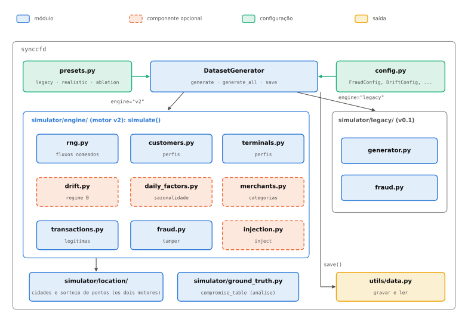
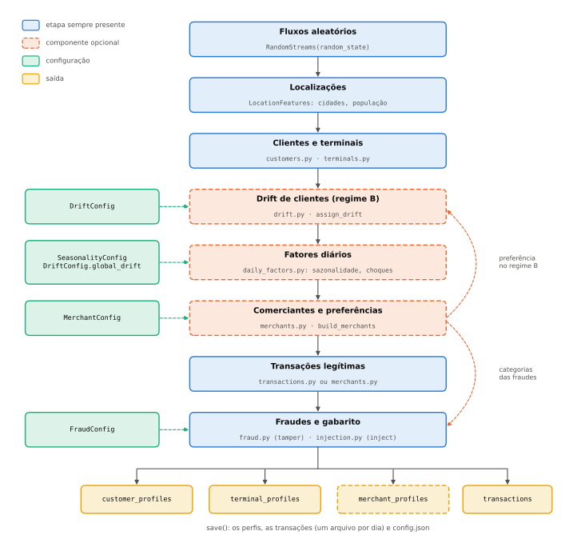

Architecture
============

This page describes how the simulator is organised: the modules, the generation
flow, the role of each configuration object and how to extend the model. The
diagrams are produced by ``scripts/diagrams.py`` (also called by
``scripts/make_figures.py``) as SVG for this page and as PDF for the dissertation.

Modules
-------

   Modules of ``synccfd``. Dashed: optional components, only used when their
   configuration is given.

``DatasetGenerator`` (``simulator/generator.py``) is the only entry point. It
receives the size of the dataset and one configuration object per component, and
chooses the engine:

- ``simulator/legacy/``: the v0.1 code, unchanged. It reproduces v0.1 exactly with
  the default configuration (checked by a golden test) and only supports the v0.1
  model.
- ``simulator/engine/``: the v2 engine, vectorised and driven only by local random
  streams. It supports every component. ``engine="auto"`` (the default) chooses it
  as soon as a component that only v2 supports is configured.

Both engines use ``simulator/location/`` (Brazilian municipalities, weighted by
population, and random points around them). ``simulator/presets.py`` builds ready
configurations (:doc:`presets`), ``simulator/config.py`` holds every configuration
object and every default value, ``simulator/ground_truth.py`` helps to analyse the
ground truth and ``utils/data.py`` writes and reads datasets.

Generation flow
---------------

   Generation flow of the v2 engine (``engine.simulate``). Each optional step runs
   only when its configuration is given.

1. **Random streams.** ``RandomStreams(random_state)`` derives one independent
   ``numpy.random.Generator`` per subsystem (``customers``, ``terminals``,
   ``merchants``, ``transactions``, ``drift``, ``fraud``) from a
   ``SeedSequence``, and one child stream per customer for the transactions.
   Switching a component on adds draws to its own stream only, so the other
   components keep their draws: without drift, a customer's transactions are the
   same whether drift is configured for the other customers or not.
2. **Locations.** ``LocationFeatures`` loads the municipalities and their
   population.
3. **Customers and terminals.** Profiles as in v0.1: location, mean amount, daily
   frequency, CNP probability, reachable terminals (within 10 km).
4. **Customer drift** (``DriftConfig``, :doc:`components/drift`). A fraction of the
   customers gets a regime B and a drift type that sets the weight of B over time.
5. **Daily factors** (``SeasonalityConfig``, ``DriftConfig.global_drift``). One
   frequency and one amount factor per day: weekday, paydays, December, trend and
   shocks.
6. **Merchants** (``MerchantConfig``, :doc:`components/merchants`). The terminals
   are grouped into physical merchants, online merchants get virtual terminals, and
   each customer gets category preferences, a spending factor and favourite
   merchants. With drift, regime B also changes the preferences.
7. **Legitimate transactions.** Per customer and day, from the customer's regime,
   the daily factors and, with merchants, the categories.
8. **Frauds and ground truth** (``FraudConfig``, :doc:`components/frauds`). With
   ``mechanism="tamper"`` (v0.1), legitimate transactions are altered and labelled;
   with ``mechanism="inject"``, fraudsters make new transactions, and the
   legitimate ones are never changed. With merchants, each scenario buys in its own
   categories.

The result is the customer, terminal and merchant profiles and the transactions.
``save()`` writes them, one transaction file per day, and ``config.json``, the
effective configuration with the version of ``synccfd`` (:doc:`output`).

Configuration objects
---------------------

Every configuration object is a frozen dataclass of ``simulator/config.py``,
validated when it is created; every default value lives there, next to a note on
why it was chosen.

.. list-table::
   :header-rows: 1
   :widths: 22 18 60

   * - Object
     - Component
     - Role
   * - ``FraudConfig``
     - frauds
     - scenarios, rates (absolute or proportional), mechanism (``tamper`` or
       ``inject``), parameters of each scenario, ``intensity_schedule`` (fraudster
       drift) and, with merchants, the categories of each scenario
   * - ``DriftConfig``
     - customer drift
     - fraction of drifting customers, weights of the drift types, distribution of
       ``t0``, ``L``, ``P`` and ``D``, size of the change between the regimes and
       ``global_drift`` (trend and shocks)
   * - ``SeasonalityConfig``
     - calendar
     - weekday, paydays and December factors
   * - ``MerchantConfig``
     - merchants
     - categories (``MerchantCategory``), terminals per merchant, online merchants,
       preferences, spending factors and loyalty
   * - ``presets``
     - all
     - ready combinations: ``legacy()``, ``realistic()``, ``ablation(step)``

``DatasetGenerator.config`` serialises all of them, with the size and the seed, to
plain JSON types.

Design principles
-----------------

- **Every component is optional.** Without its configuration, a component draws
  nothing and changes nothing, which makes the ablation of :doc:`presets` possible.
- **Local randomness.** The v2 engine never reads nor changes the global ``random``
  and ``numpy.random`` states.
- **Ground truth apart from the attributes.** What a model could not observe goes
  into ``GT_*`` columns (:doc:`output`).
- **Python 3.9.** No ``match`` and no ``X | Y`` in annotations evaluated at run
  time.

How to extend
-------------

**A new fraud scenario** (v2 engine, injection):

1. In ``config.py``, add its number to ``KNOWN_FRAUD_SCENARIOS``, its rate
   parameters (``sN_customers_per_day`` and ``sN_customer_fraction_per_day``) and its
   own parameters to ``FraudConfig``, with validation in ``__post_init__``.
2. In ``engine/injection.py``, write a function that, for one victim and one day,
   adds the new transactions to the output (``out.add``) with ``GT_FRAUD_SCENARIO``,
   a ``GT_FRAUDSTER_ID`` and a ``GT_CAMPAIGN_ID``, and call it from
   ``inject_frauds`` for the victims drawn each day (the daily count already
   follows ``rate_mode`` and ``intensity_schedule``). Draw only from the ``fraud``
   stream passed in.
3. With merchants, add its categories (``sN_categories``) and use ``_Shop`` to pick
   merchants and amounts.
4. Test that it only adds transactions (legitimate ones unchanged), that its rate
   follows the configured fraction, and its characteristic behaviour.

**A new merchant category:** pass a ``MerchantConfig(categories=...)`` with an extra
``MerchantCategory`` (channel, median amount, spread, weight, hourly profile,
opening hours, weekend factor, skimming risk, online fraction); no code changes.

**A new drift type:** add it to ``DRIFT_TYPES`` and to ``type_weights`` in
``config.py``, give its weight ``w(t)`` in ``engine/drift.py`` (``regime_weight``) and
say how a transaction uses it (by regime or interpolated) in the transaction
generation.

**A new component:** a new frozen configuration in ``config.py``, a new
``DatasetGenerator`` argument that selects the v2 engine, a new named stream
**appended** to ``STREAM_NAMES`` in ``engine/rng.py`` (never inserted, so the other streams
keep their draws), and a test that, without the component, the output is unchanged.
